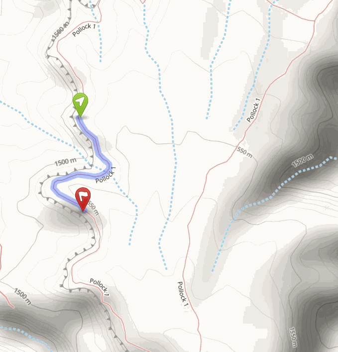
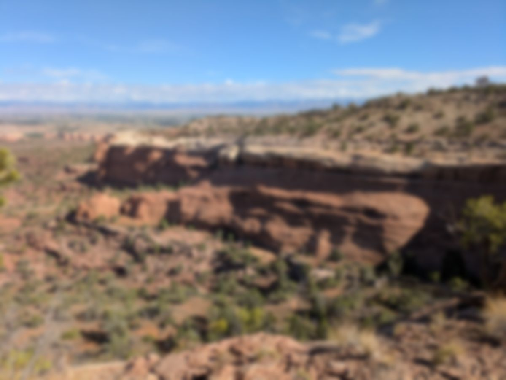
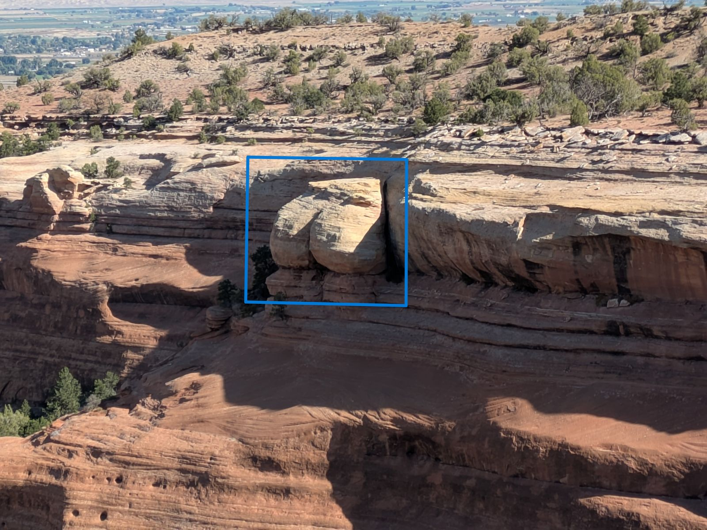
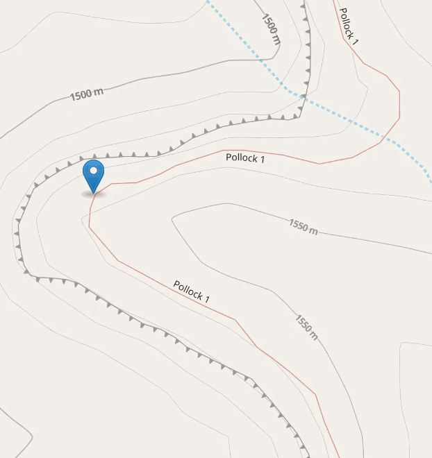

Up on the bench where the canyon runs wide,  
A plump pair of cheeks tops the trail’s west side.  
No legs and no torso, no arms to embrace,  
Just two solid glutes, holding firm in their place.  

No matter the season, no matter the phase,  
It's always a full moon up Pollock a ways.  
It looks like whoever got stuck on that rim,  
Never missed leg day, didn't skip the gym.  

So hike clockwise along with your eyes on the prize,  
Hold a steady watch outward for nature's surprise.  
Continue and you'll find, just as the trail turns,  
The palest backside that never quite burns.  

Beneath the junipers, unbothered and bare,  
Without any shorts, or discreet underwear.  
These beautiful buns that have no need to hide,  
Just waiting for you on Pollock’s backside.  

::: {.panel-tabset}

## Hints
*Click to expand the sections below.*  

::: {.callout-tip collapse="true"}
## Hint #1: Help...what am I looking for?

Somewhere on the P1 trail, you'll find a rock formation that looks like two plump butt cheeks.  

:::

::: {.callout-tip collapse="true"}
## Hint #2: In what general area should I look?

[{fig-alt="Trail map of Pollock Canyon trail P1 with the section to search highlighted in purple"}](https://www.openstreetmap.org/directions?engine=fossgis_osrm_foot&route=39.14309%2C-108.80475%3B39.14056%2C-108.80467#map=17/39.14174/-108.80261&layers=P)

:::

::: {.callout-tip collapse="true"}
## Hint #3: Ok, I need a photo hint please.

{fig-alt="Blurred photo of the landscape around the hidden feature"}

:::

## Answer

::: {.callout-tip appearance="minimal" collapse="false"}
[{fig-alt="Answer photo: a rock formation that looks like two plump butt cheeks, marked on the photo"}](images/p1_backside_answer_annotated.jpg)

GPS coordinates of this photo: 39.14136, -108.80566

[{fig-alt="Map with a pin marking where the answer photo was taken"}](https://www.openstreetmap.org/?mlat=39.14136&mlon=-108.80566&zoom=19)

*Thanks to our friends at Mesa Monument Striders for spotting this cheeky view!*

:::

:::
